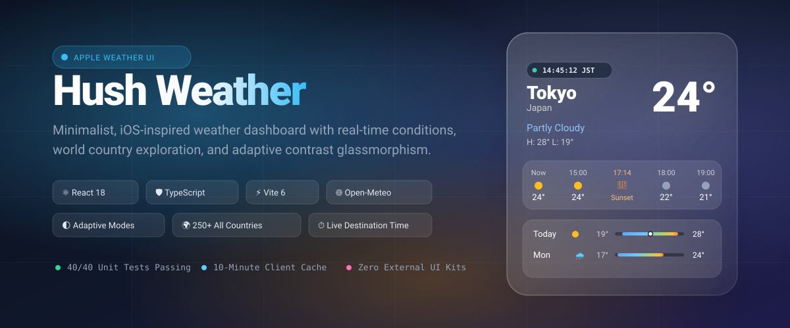
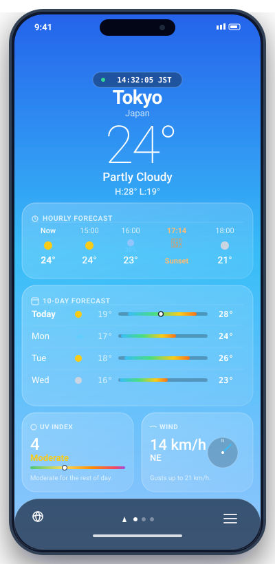
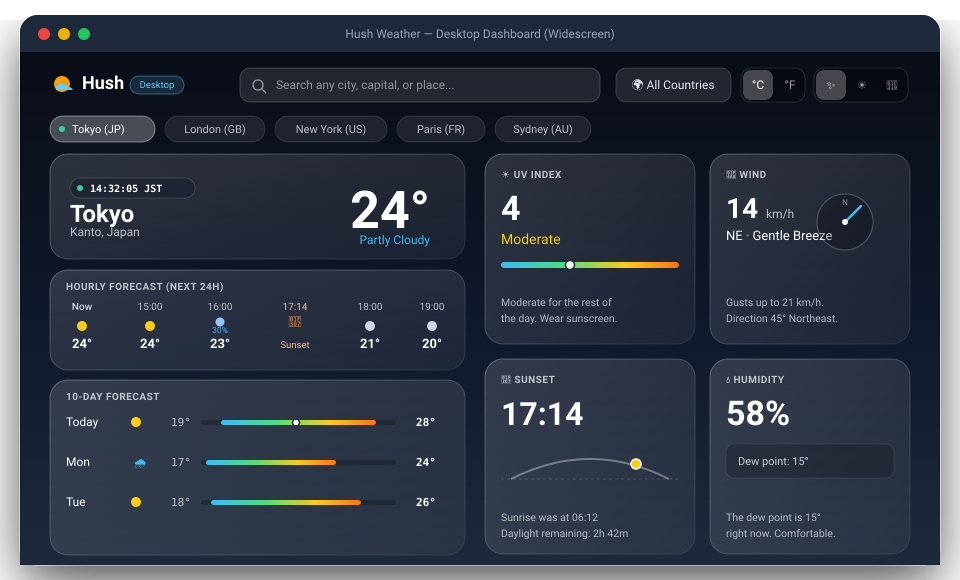
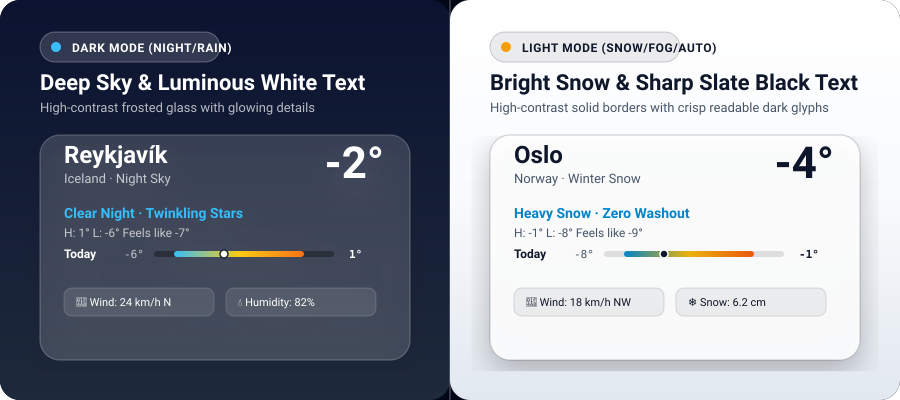
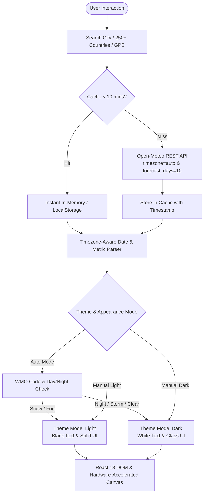

<div align="center">



# Hush Weather

**An Apple iOS Weather-inspired meteorological web application crafted with React 18, TypeScript, pure CSS variables, and the Open-Meteo API.**

[](https://github.com/Anowaarr/Hush-Weather/actions/workflows/ci.yml)
[](https://vitest.dev/)
[](https://www.typescriptlang.org/)
[](https://react.dev/)
[](https://vitejs.dev/)
[](LICENSE)
[](https://github.com/Anowaarr/Hush-Weather/pulls)

[🚀 Live Demo](https://anowaarr.github.io/Hush-Weather/) · [✨ Report Bug](https://github.com/Anowaarr/Hush-Weather/issues) · [💡 Request Feature](https://github.com/Anowaarr/Hush-Weather/issues)

</div>

---

## 🌟 Visual Showcase

<div align="center">

| 📱 Mobile iOS Weather View | 💻 PC & Desktop Widescreen Dashboard |
| :---: | :---: |
|  |  |

</div>

---

## 🌓 Adaptive Contrast & Light/Dark Theme System

> **Eliminating washed-out UI:** Built with intelligent WCAG AA compliant contrast adaptation.

<div align="center">
  
</div>

* **White & Bright Backgrounds (Snow, Fog, Bright Daylight):** The UI elements, borders, icons, and typography automatically switch to deep slate black (`#0f172a`), maintaining razor-sharp legibility without washed-out text.
* **Dark Sky Backgrounds (Night, Storms, Rain, Overcast):** The UI seamlessly transitions to frosted glass (`rgba(255, 255, 255, 0.15)`) with pure white typography (`#ffffff`) and glowing indicators.
* **Manual Override & Quick Switcher:** Users can toggle between `Auto (Weather-adaptive)`, `Light (White background / Black UI)`, and `Dark (Dark sky / White UI)` directly from the desktop navigation bar or the measurement settings modal.

---

## ✨ Features at a Glance

### 📱 Authentic Apple iOS Mobile Experience
- **Condensing Sticky Hero:** Large current temperature (96px, ultra-light 200 weight), city name, weather condition, and high/low that collapses smoothly into a frosted glass compact header on scroll.
- **Dynamic Atmospheric Canvas:** Realistic particle physics layer simulating drifting clouds, twinkling stars, angled rain streaks, soft fluttering snowflakes, and thunderstorm lightning. Honors `prefers-reduced-motion`.
- **24-Hour Hourly Strip:** Scroll-snapping horizontal strip showing hourly conditions, light blue precipitation probabilities (&ge; 20%), and chronologically injected sunrise/sunset milestones.
- **10-Day Range Bars:** Cool-to-warm colored range bars positioned proportionally against the entire 10-day temperature span, complete with a current temperature indicator pip on the Today row.
- **8 Meteorological Detail Tiles:** UV Index gauge bar, SVG quadratic Sun trajectory arc, live rotating Wind compass needle, Feels Like calculation, Humidity with Magnus-Tetens Dew Point, Visibility, Pressure, and 24h Precipitation.
- **Gesture Navigation:** Smooth touch swipe to change saved cities, page indicator dots, and mobile saved places drawer.

### 💻 PC & Desktop-Optimized Dashboard
- **Responsive Dual-Column Layout:** Centers a spacious, balanced widescreen layout on screens &ge; 1024px.
- **Live Autocomplete Search Bar:** Instant debounced lookup with country, state/region, and geographical coordinates.
- **🌍 250+ All Countries Directory:** Complete alphabetical and regional directory (Europe, Americas, Asia, Africa, Oceania) with national flag emojis to explore real-time weather in any nation on Earth.
- **⏱️ Live Destination Wall-Clock:** Live ticking clock (`HH:mm:ss`) synchronized with the destination's exact IANA timezone and pulsing beacon indicator.
- **Smooth Trackpad Scrolling:** Unrestricted native trackpad scroll pass-through and bubbling.

### ⚙️ Customizable Measurement System
- **Temperature:** Celsius (&deg;C) or Fahrenheit (&deg;F)
- **Wind Speed:** Kilometers per hour (km/h) or Miles per hour (mph)
- **Precipitation:** Millimeters (mm) or Inches (in)
- **Pressure:** Hectopascals (hPa) or Inches of Mercury (inHg)
- **Visibility:** Kilometers (km) or Miles (mi)
- **Automatic Locale Detection:** Defaults based on the user's browser locale and persists across sessions in `localStorage`.

---

## 🏗️ Architecture & Data Flow



---

## 📁 Project Structure

```text
Hush-Weather/
├── .github/
│   ├── ISSUE_TEMPLATE/
│   │   ├── bug_report.md         # Structured bug issue template
│   │   └── feature_request.md    # Feature enhancement proposal template
│   ├── PULL_REQUEST_TEMPLATE.md  # PR checklist and standards
│   └── workflows/
│       ├── ci.yml                # CI pipeline: lint, typecheck, test, build
│       └── deploy.yml            # Automatic GitHub Pages deployment
├── docs/
│   └── screenshots/              # High-resolution vector SVG mockups & banners
│       ├── banner.svg            # Hero banner graphic
│       ├── mobile-preview.svg    # Vector iPhone mockup
│       ├── desktop-preview.svg   # Vector desktop dashboard mockup
│       └── adaptive-themes.svg   # Light vs. Dark contrast showcase
├── src/
│   ├── api/
│   │   ├── cache.ts              # 10-minute client caching layer
│   │   └── openMeteo.ts          # Open-Meteo forecast and geocoding clients
│   ├── components/
│   │   ├── Background/           # Dynamic gradients and WeatherCanvas simulation
│   │   ├── Countries/            # 250+ World countries directory modal & filters
│   │   ├── Daily/                # 10-day forecast with proportional range bars
│   │   ├── Details/              # 8 meteorological metric tiles (UV, Sun arc, Wind, etc.)
│   │   ├── Hero/                 # Hero section and scroll-condensing sticky header
│   │   ├── Hourly/               # 24-hour horizontal scrolling forecast strip
│   │   ├── Navigation/           # Desktop top bar, quick chips, and mobile bottom bar
│   │   ├── Places/               # Saved locations drawer & geocoding search
│   │   ├── Settings/             # Measurement units & appearance contrast modal
│   │   └── UI/                   # Skeletons, error states, offline banner, footer
│   ├── constants/
│   │   ├── countries.ts          # Directory of 250+ countries with ISO codes & capitals
│   │   ├── defaultLocations.ts   # Curated starting cities
│   │   └── weatherCodes.ts       # Comprehensive WMO code-to-theme mapping
│   ├── hooks/
│   │   ├── useDebounce.ts        # Input debouncing hook
│   │   ├── useGeolocation.ts     # Browser GPS geolocation hook
│   │   ├── useLiveTime.ts        # Destination timezone ticking clock hook
│   │   ├── useLocalStorage.ts    # Resilient type-safe storage sync hook
│   │   ├── useScrollPosition.ts  # Scroll position tracking hook
│   │   └── useWeather.ts         # Weather data lifecycle & refresh hook
│   ├── types/
│   │   ├── units.ts              # Unit definitions & appearance mode types
│   │   └── weather.ts            # Meteorological interfaces & WMO theme types
│   ├── utils/
│   │   ├── date.ts               # Local timezone date & sun math utilities
│   │   └── units.ts              # Conversions, dew point, and contrast resolver
│   ├── App.tsx                   # Main application orchestrator
│   ├── index.css                 # CSS variables, glassmorphism tokens, and reset
│   └── main.tsx                  # React DOM client entry point
├── index.html                    # HTML shell
├── LICENSE                       # MIT License
├── package.json                  # Scripts and dependencies
├── tsconfig.json                 # TypeScript strict configuration
└── vite.config.ts                # Vite & Vitest configuration
```

---

## 🚀 Getting Started

### Prerequisites
- **Node.js:** `18.0.0` or higher
- **npm:** `9.0.0` or higher

### 1. Clone the repository
```bash
git clone https://github.com/Anowaarr/Hush-Weather.git
cd Hush-Weather
```

### 2. Install dependencies
```bash
npm install
```

### 3. Start development server
```bash
npm run dev
```
Open [http://localhost:3000](http://localhost:3000) in your browser.

### 4. Run test suite
```bash
npm test
```

### 5. Type checking & Linting
```bash
npm run typecheck
npm run lint
```

### 6. Build for production
```bash
npm run build
npm run preview
```

---

## ⌨️ Shortcuts & Gestures

| Action | Mobile Gesture | Desktop / Keyboard |
| :--- | :--- | :--- |
| **Next Saved City** | Swipe left | Right Arrow (`→`) |
| **Previous Saved City** | Swipe right | Left Arrow (`←`) |
| **Search Locations** | Tap search box | Focus search input / `/` |
| **Dismiss Modals** | Tap close / drag down | Escape key (`Esc`) |
| **Quick Unit Switch** | Settings modal | Click `°C` / `°F` in top bar |
| **Quick Appearance Mode** | Settings modal | Click `Auto` / `Light` / `Dark` |

---

## 🌤️ Weather Themes & WMO Mapping

| Theme | Applicable Conditions | Particles / Visuals |
| :--- | :--- | :--- |
| **Clear Day** | WMO 0, 1 (Daytime) | Radiant azure gradient, warm sunlight glow |
| **Clear Night** | WMO 0, 1 (Nighttime) | Deep midnight blue sky with twinkling star canvas |
| **Partly Cloudy** | WMO 2 | Drifting translucent cumulus cloud puffs |
| **Cloudy / Overcast**| WMO 3 | Soft layered cloud coverage with diffused light |
| **Fog & Mist** | WMO 45, 48 | Horizontal drifting atmospheric mist bands |
| **Rain & Drizzle** | WMO 51–67, 80–82 | Angled falling rain streaks with ground bounce |
| **Snow** | WMO 71–77, 85–86 | Fluttering sinusoidal snowflakes drifting gently |
| **Thunderstorm** | WMO 95–99 | Heavy rain simulation with randomized lightning flashes |

---

## 📜 Credits & Attribution

* **Weather Data:** Forecast models, historical data, and geocoding provided by [Open-Meteo.com](https://open-meteo.com/) under the [CC BY 4.0](https://creativecommons.org/licenses/by/4.0/) license.
* **Iconography:** Clean semantic icons provided by [Lucide React](https://lucide.dev/) under the ISC License.

---

## ⚖️ Disclaimer

Hush is an independent open-source web project created for portfolio and educational purposes, inspired by Apple's iOS Weather user interface design. This project is **not** affiliated with, endorsed by, or sponsored by Apple Inc. Apple, iOS, and SF Symbols are registered trademarks of Apple Inc.

---

## 📄 License

This project is licensed under the [MIT License](LICENSE).
